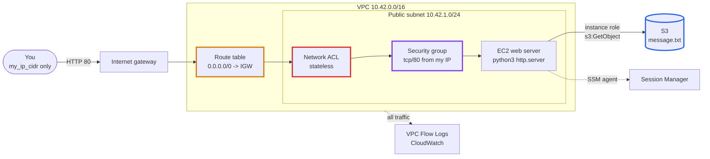

# AWS Cloud Troubleshooting Lab


A small AWS environment that you break on purpose, then fix. One Terraform variable injects one of four common faults (VPC routing, network ACL, security group, IAM). Each fault has a root-cause write-up with the symptom, the commands that find it, the fix and how to prevent it. A `random` mode hides which fault is active, for practice or for interviews.

Built with Terraform, EC2 (Amazon Linux 2023), VPC, network ACLs, security groups, IAM, S3, VPC Flow Logs, Session Manager and VPC Reachability Analyzer.

## Architecture



The coloured boxes are where the four faults go. When everything works, the page shows the text of `message.txt` from S3.

## Scenarios

| `scenario` | Fault | What you see | Write-up |
| --- | --- | --- | --- |
| `missing-igw-route` | Public route table has no `0.0.0.0/0` route | Timeout | [01](docs/scenarios/01-missing-igw-route.md) |
| `nacl-ephemeral` | NACL has no outbound rule for ephemeral ports | Timeout, even though the security group is correct | [02](docs/scenarios/02-nacl-ephemeral.md) |
| `sg-wrong-port` | Security group opens 8080, server listens on 80 | Timeout | [03](docs/scenarios/03-sg-wrong-port.md) |
| `iam-object-arn` | `s3:GetObject` granted on the bucket ARN, not `bucket/*` | HTTP 502 with "Forbidden" | [04](docs/scenarios/04-iam-object-arn.md) |
| `random` | One of the four, not shown | It depends | |
| `healthy` | None | HTTP 200 with the S3 message | |

## Demo

> **Demo video:** _placeholder. Record one `random` run: the symptom, `scripts/diagnose.sh`, the fix and the green result. Add the link here before you delete the AWS resources._

## Run the lab

Requirements: Terraform 1.6 or later, AWS CLI v2, and credentials for a test account (not production).

```bash
cd terraform
cp terraform.tfvars.example terraform.tfvars
# set my_ip_cidr to your IP: curl -s https://checkip.amazonaws.com
terraform init
terraform apply -var scenario=healthy        # check that the page works first
terraform apply -var scenario=random         # break it
curl -m 8 "$(terraform output -raw url)"
```

The instance needs about a minute after the first apply before it answers.

Find the fault with the AWS console or CLI, or run the read-only checks:

```bash
cd ..
scripts/diagnose.sh                # 5 checks: HTTP, routes, security group, NACL, IAM
scripts/diagnose.sh --reachability # also runs VPC Reachability Analyzer (billed per analysis)
```

When you think you know the answer:

```bash
terraform -chdir=terraform output -raw hidden_fault
terraform -chdir=terraform apply -var scenario=healthy
```

Get a shell on the instance without SSH keys or port 22 (works in every scenario except `missing-igw-route`):

```bash
aws ssm start-session --target "$(terraform -chdir=terraform output -raw instance_id)"
```

## How to write a root-cause analysis

Each write-up in `docs/scenarios/` uses the same structure. Use it for real incidents too:

1. **Symptom:** what the user sees, in their words. Timeout or error code?
2. **Investigation:** each check, the command, and what the output proved or ruled out. Work from the outside in: DNS, route, NACL, security group, host, process, permissions.
3. **Root cause:** one paragraph on why it failed, not only what was wrong.
4. **Fix:** the exact change.
5. **Prevention:** the test, alarm or guardrail that stops it happening again.

## Design decisions

- **One fault at a time.** Each fault is a single `count` or conditional in Terraform (search for `FAULT` in `terraform/`). Terraform tests with mocked providers check that each scenario changes exactly its own resource.
- **The server needs no downloads.** It uses only `python3` and the AWS CLI that ship with Amazon Linux 2023, so it starts even when the network is broken.
- **Safe by default.** Only `my_ip_cidr` can reach the server (`0.0.0.0/0` is rejected by validation). IMDSv2 is required. The root volume is encrypted. Access is through Session Manager, not SSH.
- **Evidence is on.** VPC Flow Logs record all traffic with a 1-minute aggregation interval, so `REJECT` records appear quickly.

## Tests

```bash
cd terraform
terraform init
terraform test
```

No AWS account is needed: the AWS and random providers are mocked. CI also runs `terraform validate`, Checkov and ShellCheck.

## Cost

A `t3.micro` instance, its public IPv4 address, a small EBS volume and flow logs. Each Reachability Analyzer analysis is billed. Destroy the lab when you finish.

## Clean up

```bash
terraform -chdir=terraform destroy -var scenario=healthy
```

## Licence

MIT. See [LICENSE](LICENSE).
